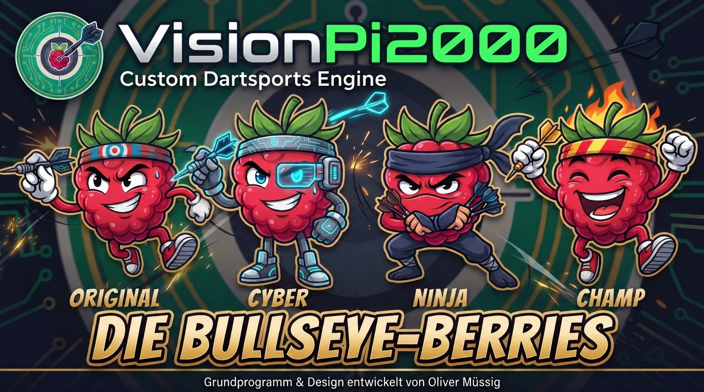

# VisionPi2000 / OpenRetroDart



**Custom Dartsports Engine • Developed by Oliver Müssig**  
**Ein alternatives, plattformunabhängiges Source-Available-Software- und Hardwaresystem als Retrofitlösung für klassische elektronische Dartautomaten der 90er- und 2000er-Jahre (z. B. Turnierdart 2000 / Vision Dart Gehäuse).**

> **Wichtiger rechtlicher Hinweis (Disclaimer):**  
> *Dieses Projekt ist eine unabhängige, private Hobby-Entwicklung und steht in keinerlei Verbindung, Partnerschaft oder Sponsoring zu den Herstellern der Original-Hardware (wie Löwen-Entertainment o. Ä.). Alle genannten Marken-, Produkt- und Firmennamen sind Eigentum ihrer jeweiligen Inhaber und dienen hier ausschließlich der technischen Identifikation und Kompatibilitätsbeschreibung (Ersatzteil-, Reparatur- und Retrofit-Kontext). Das System greift nicht in geschützte Herstellungsverfahren ein, sondern stellt eine freie, alternative Firmware bereit, um defekte Original-Steuereinheiten privater Altgeräte durch moderne Eigenbau-Komponenten (z. B. Raspberry Pi / Arduino) zu ersetzen.*

**Die Nutzung, Modifikation und Weiterverbreitung dieses Projekts ist ausschließlich für private, nicht-kommerzielle Zwecke gestattet. Jegliche kommerzielle Nutzung oder Verwertung ist ausdrücklich untersagt, es sei denn, es liegt eine ausdrückliche schriftliche Genehmigung des Autors vor.**

---

## 🎯 Über das Projekt & Zielsetzung

Klassische Dartautomaten aus den späten 90er- und 2000er-Jahren (wie der **Turnierdart 2000** oder das **Vision Dart**) sind mechanisch oft unverwüstlich, leiden heute jedoch häufig unter defekten, veralteten oder nicht mehr beschaffbaren Original-Hauptplatinen (CPU-Boards). 

**VisionPi2000** bietet eine nachhaltige Retrofitlösung, um solche Automaten vor dem Elektroschrott zu bewahren. Das Konzept erlaubt es, die **voll funktionsfähige Original-Peripherie** weiterzuverwenden – namentlich:

* Das originale Gehäuse und die 4×16 Treffer-Matrix,
* Die originalen kaskadierten MAX7219-basierten LED-/Segmentanzeigen, Cricket-Markierungen, das Bullseye-Icon und die Spieler-Statuslampen,
* Die originale **5-Tasten-Bedienung** (Rot, Blau, Grau, Start, Spielerwechsel) für die komplette Navigation und Steuerung im Gehäuse – inklusive **autonomer Leuchtmelder-Ansteuerung** (Aus, Dauerlicht, 2-Hz-Blinken) für die Tasten *Start* und *Spielerwechsel*.

*(Hinweis zur Sensorik & Tastenbeleuchtung: Die Wurferkennung für Fehlwürfe und der Spielerwechsel werden über moderne Piezo-Vibrationssensoren und Infrarot-Lichtschranken abgebildet. Für die Beleuchtung der Start- und Spielerwechsel-Taste werden passende Arcade-LED-Birnchen verwendet, die über [dartdoktor.de](https://www.dartdoktor.de) bezogen werden können. Um das Projekt kostengünstig zu halten, wurde bewusst auf separate Transistortreiberstufen verzichtet – die stromsparenden LED-Birnchen werden direkt über die Optokoppler angesteuert).*

---

## ⚙️ Technische Besonderheiten & Neue Features

* **Clevere Weiternutzung von Original-Platinenabschnitten:** Um aufwendiges Neulöten oder Adapter-Basteleien an den empfindlichen Flachbandkabeln zu vermeiden, werden gezielt **herausgetrennte Segmente aus dem Original-Platinenboard** (insbesondere die Sektionen mit dem Matrixstecker, der Spannungsversorgung, der Displayspannungsversorgung und dem Tasterstecker) weiterverwendet. Detaillierte Fotos und Anleitungen dazu befinden sich im Ordner **`Dokumentation/`** dieses Repositories.
* **Speziell für den Raspberry Pi 4B (1 GB RAM) optimiert:** Durch tiefgreifende Software- und Betriebssystem-Optimierungen (24-Bit-Surfaces, einmalig allokierte RAM-Puffer im Web-Streamer, Deaktivierung unnötiger Systemdienste und 16-MB-Deckelung des Systemd-Journals im RAM) läuft das gesamte System inklusive Online-Multiplayer und Live-Streaming absolut stabil auf dem günstigen **Raspberry Pi 4B mit nur 1 GB RAM**. Das senkt die Hardware-Anschaffungskosten spürbar, ohne Kompromisse bei der Performance einzugehen.
* **Präzises Hardware-Mapping (Display-Mapper):** Die mitgelieferte `display_mapper_Vision_Dart.py` wurde speziell für das originale Display-Layout des **Turnierdart 2000 / Vision Dart** entwickelt. Sie berücksichtigt exakt die platinenspezifischen Segment- und Zeilen-Zuordnungen der **klassischen Ausführung mit bedrahteten THT-LEDs** (keine SMD-Bestückung) und steuert alle 5 MAX7219-Stränge zu 100 % synchron über den Arduino Mega an.
* **Vollständige 5-Tasten-Bedienung & Kombi-Shortcuts:** Die Software ist kompromisslos auf die Bedienung über die originalen Gehäusetasten optimiert. Durch gleichzeitiges Gedrückthalten der Tasten **ROT + BLAU + GRAU** lässt sich im Hauptmenü die System- und Versionsübersicht aller Module aufrufen oder während eines laufenden Spiels das Abbruch-Menü öffnen.
* **Umfangreicher Spielekatalog:**
  * **X01 (301 / 501 / 701):** Mit Open In/Out, Double In, Double Out, Master Out sowie echtem **Team-Modus** (2er-Teams für 4, 6 oder 8 Spieler).
  * **Cricket:** Standard, Cut Throat, *You Pick It* (mit Vorab-Zahlenauswahl vor Runde 1) und *Crazy (Zufall)* – inklusive dynamisch skalierender Spielerbalken.
  * **Fruit Splasher:** Exklusives Action-Game mit den Modi *Juice Press* (Standard, Party, Battle-Modus mit Punkte-Klau über Bullseye) sowie *Berry Hunt* (10 oder 15 Runden mit direktem Hardware-Mapping auf die 6 Cricket-Anzeigen und das Bullseye-Symbol).
  * **Klassiker & Training:** *Shanghai* (inkl. Sofortsieg), *Split Score* (9 Runden Disziplin-Test), *Around the Clock* (Standard & Double Only) und *Elimination*.
  * **Solo- / Bot-Modus (*Bullseye-Berry*):** Animierter Computergegner in 3 Schwierigkeitsstufen (Stufe 1: Original, Stufe 2: Cyber, Stufe 3: Ninja) für bis zu 7 menschliche Mitspieler (bei 8 menschlichen Spielern wird der Bot automatisch ausgeblendet).
* **MQTT Online-Multiplayer:** Vernetze zwei oder mehr VisionPi2000-Automaten über das Internet oder lokale Netzwerk. Ein Automat fungiert als *Host (Lobby)*, weitere treten als *Gast* (inklusive QR-Code-Raumanzeige für parallelen Videostream) bei.
* **Integrierter Web-Streamer (Live-View):** Über Port `8080` (`http://<IP-des-Pi>:8080`) stellt der Automat einen extrem ressourcenschonenden, asynchronen MJPEG-Livestream im Cyber-Circuit-Design bereit (`1280x720` bei 16:9 bzw. `1024x768` bei 4:3). Ohne verbundene Zuschauer verbraucht der Streamer **0 % CPU und 0 MB RAM**.
* **Zero-Lag Asset-Preloading:** Während des Boot-Splashscreens werden sämtliche Schriften, Soundeffekte, Hintergründe und Bot-Animationen einmalig in einen globalen RAM-Cache geladen. Dadurch starten alle Spiele ohne Nachladezeiten (0 ms) und schonen die SD-Karte.
* **Native 4:3- & 16:9-Unterstützung:** Volle Unterstützung für klassische 4:3-Monitore (`1024x768`) sowie moderne 16:9-Widescreen-Displays (`1920x1080`), umschaltbar direkt über das Service-Menü oder die `settings.json`.

---

## 🛠️ System-Eigenschaften & Betriebssystem-Hinweise (ab Version 1.1.13 / Stable)

* **Ausfallsicheres Betriebssystem (Read-Only OverlayFS):** Das System läuft im geschützten Read-Only-Modus (`OverlayFS`). Dadurch sind Dateisystem-Schäden an der SD-Karte ausgeschlossen, wenn der Automat nach dem Spielen direkt über den Hauptschalter stromlos geschaltet wird.
* **Abgehärtetes Sicherheitskonzept (Fertig-Image / Appliance-Modus):** Im bereitgestellten SD-Karten-Image ist **SSH standardmäßig gesperrt** und es ist **kein Benutzerpasswort hinterlegt**. Es existieren weder Standard-Passwörter noch offene Fernzugriffsports im Heimnetzwerk – Bedienung, Konfiguration und System-Updates erfolgen ausschließlich direkt über den Automaten selbst.
* **Intelligente Konfiguration auf der Boot-Partition:** Obwohl das Hauptsystem schreibgeschützt ist, liegt die zentrale Konfigurationsdatei `settings.json` (für Bildformat, Display-Mapper, MQTT-Broker und WLAN-Daten) per Symlink verknüpft direkt auf der ungeschützten FAT32-Boot-Partition (`/boot/firmware/settings.json`):
  1. **Über das Automaten-Service-Menü (WPS):** Im Service-Menü unter „WLAN & WPS“ auf Knopfdruck mit dem Router koppeln.
  2. **Manuell am PC (Offline):** SD-Karte in einen beliebigen PC stecken und die Datei `settings.json` direkt auf dem Laufwerk `bootfs` mit einem Texteditor anpassen (`"wifi_ssid"`, `"wifi_password"`, `"format": "16:9"` oder `"4:3"`).
* **Integriertes Service-Menü, Spieleanleitung & Projekt-Info:** Direkt über das Hauptmenü aufrufbare Module im Cyber-Circuit-Design für Hardware-Diagnose (Matrix-, Sensor-, Lampen- und MAX7219-Tests), detailliertes Regelwerk aller Spiele (mit Blätterfunktion) und System-Informationen.
* **Online-Update (OTA) über den `stable`-Branch:** Über das Service-Menü entsperrt das System kurzzeitig die Partition (`/media/root-ro`), lädt den aktuellen Stand aus dem **`stable`**-Zweig von GitHub in den RAM, bettet benötigte Python-Module (`paho-mqtt`, `qrcode`) direkt Trixie-sicher ein, rüstet die RAM-/System-Optimierungen nach und verriegelt die SD-Karte anschließend sofort wieder.

---

## 🧰 Benötigte Hardware & Stückliste

### Kernkomponenten & Peripherie

* **Host-System:** Raspberry Pi 4B (**1 GB RAM Variante** – dank gezielter RAM-Optimierung der gesamten Engine vollkommen ausreichend; alternativ 2 GB Variante) inklusive passendem Gehäuse und Micro-SD-Karte (8 GB) – ca. **55,00 € – 70,00 €** (*Hinweis: Der Raspberry Pi 3B ist aufgrund instabiler USB-Verbindungen zum Arduino ausgeschlossen*).
* **Interface-Brücke:** Arduino Mega 2560 Klon (z. B. Keyestudio Mega 2560 Plus) – ca. **15,00 € – 20,00 €** zur Ansteuerung der Matrix, der gemultiplexten LED-/Segmentanzeigen (MAX7219-Kaskaden), der Tasten-Leuchtmelder sowie der Sensor-Komponenten.
* **Original-Platinenabschnitte (Reuse):** Heraustrennte Original-Platinenteile (Matrixstecker, Spannungsversorgung, Displayspannungsversorgung und Tasterstecker) zur sauberen und passgenauen Weiternutzung der Originalkabelbäume.
* **Tastenbeleuchtung (Start & Spielerwechsel):** 2× **Arcade-LED-Birnchen** (erhältlich über [dartdoktor.de](https://www.dartdoktor.de)). Die sparsamen LED-Birnchen ermöglichen eine **direkte Ansteuerung über die Optokoppler**, wodurch zusätzliche Transistortreiberstufen komplett eingespart werden.
* **Anzeigen-Peripherie:** Originale LED-Kaskaden und Segmentdisplays des Automaten (in **bedrahteter THT-Ausführung**).

### Ergänzende Hardware

| Komponente | Beschreibung / Details | Ungefährer Preis |
| :--- | :--- | :--- |
| **GeeekPi Terminal Block Breakout Board** | HAT mit Reset-Button & LED-Anzeige für Arduino MEGA 2560 R3 | ca. 31,99 € |
| **Keenso Klemmenblock Breakout-Leiterplatte** | IDC20P 20Pin Schnittstellenhalterung mit DIN-Schienen-Montagefüßen | ca. 15,19 € |
| **DollaTek ATX-Netzteilplatine** | ATX-Netzteil Breakout-Transferplatine / Steckdosenverdrahtungsadapter | ca. 7,99 € |
| **Tbest Micro-HDMI-zu-VGA-Adapter** | Videokonverter-Adapter (1080P) für Raspberry Pi 4B mit Netzteilfunktion | ca. 9,87 € |
| **Nongxiang USB-Ladegerät (2er-Pack)** | 40W Mehrfachstecker (USB-A & USB-C, PD + QC3.0 Netzteile) - Optional, wenn Trennung der Spannungsquellen erwünscht | ca. 22,99 € |
| **Hailege E18-D80NK** | 2 Stk. Infrarot-Lichtschranken / Hindernisvermeidungssensoren | ca. 9,79 € |
| **Youmile Piezoelektrischer Keramik-Vibrationssensor** | 5 Stk. Modul Analogue Controller mit Dupont-Kabel | ca. 7,99 € |
| **Arcade-LED-Birnchen (für Start & Spielerwechsel)** | 2 Stk. über [dartdoktor.de](https://www.dartdoktor.de) beziehbare LED-Leuchtmittel zur Direkt-Ansteuerung über Optokoppler | ca. 4,00 € |
| **Speedlink TWOXO Stereo PC Lautsprecher** | Klein, 3,5mm Klinke, 10W, schwarz | ca. 8,00 € |
| **QWORK Hutschiene (3 Stk.)** | Montageschiene DIN, 35 mm breit, 7,5 mm hoch, 300 mm lang | *Variabel* |
| **DST-1R4P-N 4-Kanal Optokoppler-Platine** | Isolationsmodul / PLC Signalwandlerplatine zur sicheren Signaltrennung & Taster-LED-Ansteuerung (Variante 5V/24V) | ca. 13,99 € |
| **Binmiza Hutschiene Adapter Set** | 20 Stk. (10 Sätze) PCB DIN C45 Halter mit Schrauben | ca. 7,99 € |

---

### 💰 Gesamtkosten-Kalkulation (Ungefährer Richtwert)

Durch die konsequente Optimierung der Software auf den **Raspberry Pi 4B mit 1 GB RAM**, den Verzicht auf separate Transistortreiberstufen sowie die clevere Weiternutzung von herausgetrennten Original-Platinenabschnitten reduzieren sich die Gesamtkosten des Umbaus deutlich:

* **Raspberry Pi 4B (1 GB RAM) inkl. Gehäuse & 8GB SD-Karte:** ca. 60,00 €
* **Arduino Mega 2560 Klon:** ca. 18,00 €
* **Zusatzhardware & Module (Breakout-Boards, ATX-Platine, Optokoppler-Platine, Sensoren, Arcade-LED-Birnchen über dartdoktor.de, Lautsprecher, Hutschienen-Halter etc.):** ca. 139,79 €
* **Ungefährer Gesamtpreis (Summe der Komponenten):** **ca. 217,79 €** *(exklusive variabel bepreister Hutschienen)*

---

## 🔌 Verdrahtung & Schnittstellenbeschreibung

> **⚠️ Wichtiger Sicherheitshinweis zur Verkabelung:**  
> Werden mehrere separate Netzteile/Stromquellen (z. B. USB-Netzteile für Raspberry Pi und Verstärker/Peripherie) im System verwendet, **müssen unbedingt sämtliche Massen (GND) aller verwendeten Netzteile und Komponenten sternförmig miteinander verbunden werden**, um Potentialunterschiede, Signalfehler und Fehlfunktionen bei der seriellen Datenübertragung zu verhindern!

Eine detaillierte, komplette Schnittstellenbeschreibung inklusive Pin-Belegungen (Matrix, 7-Segment-Anzeigen, Leuchtmelder, Beleuchtungsrelais, IR-Sensor, Piezo) sowie anschauliche Detailfotos zur Wiederverwendung der herausgetrennten Original-Platinenabschnitte befinden sich im Ordner **`Dokumentation/`** dieses Repositories.

---

## 🚀 Installation & Update

### 1. Vorbereitung der Hardware (immer erforderlich)

Flashe zunächst den bereitgestellten Arduino-Sketch (`Arduino-MEGA-2560_Schnittstellen_VisionPi2000.ino`) über die Arduino IDE auf den Arduino Mega 2560.

---

### 2. Option A: Fertiges SD-Karten-Image flashen (Empfohlen)

Der einfachste und schnellste Weg ist das einsatzbereite **VisionPi2000-Image (`.img.xz`)** aus dem Bereich **Releases** dieses Repositories. Alle System-Optimierungen, Kiosk-Einstellungen und der Schreibschutz sind bereits vorkonfiguriert.

1. **Image herunterladen:** Lade die aktuelle `.img.xz`-Datei aus den **GitHub Releases** herunter (ein vorheriges Entpacken ist nicht notwendig).
2. **Auf SD-Karte schreiben (mind. 8 GB):**
   * **Mit balenaEtcher:** *Flash from file* → `.img.xz` auswählen → SD-Karte wählen → *Flash!*
   * **Mit Raspberry Pi Imager:** *Raspberry Pi 4* wählen → *Betriebssystem wählen → Eigenes Image verwenden* → `.img.xz` auswählen → SD-Karte wählen. **Wichtig:** Bei der Abfrage zu den *OS-Anpassungen* auf **„Nein“** klicken (keine eigenen Benutzer-, Passwort- oder WLAN-Daten injizieren), damit das Image im sicheren Werkszustand bleibt.
3. **Erster Start im Automaten:** Stecke die SD-Karte in den Raspberry Pi 4B und schalte den Automaten ein. Beim allerersten Start erweitert das System automatisch die Partition auf die volle Kapazität deiner SD-Karte, erzeugt eindeutige System-IDs, aktiviert den **OverlayFS-Schreibschutz** und führt **einmalig einen automatischen Neustart** durch. *(Den Automaten während dieser ersten ca. 1–2 Minuten bitte nicht ausschalten.)*
4. **WLAN verbinden:** Nach dem Neustart kannst du den Automaten direkt im **Service-Menü per WPS-Knopfdruck** mit deinem Router koppeln – alternativ hinterlegst du SSID und Passwort offline am PC in der Datei `settings.json` auf der Partition `bootfs`.

> **🔒 Sicherheitskonzept des fertigen Images (Appliance-Modus):**  
> Aus Sicherheitsgründen ist **SSH im fertigen Image dauerhaft gesperrt** und für den Systembenutzer **`visionpi2000` ist kein Login-Passwort hinterlegt**. Es gibt somit keine bekannten Standard-Passwörter und keine offenen Fernzugriffsports im Heimnetzwerk. Der Zugriff auf Einstellungen, WLAN-Kopplung, Hardware-Tests und **System-Updates erfolgt ausschließlich direkt am Automaten über das integrierte Service-Menü**.

---

### 3. Option B: Manuelle Installation (Alternative für erfahrene Nutzer)

Wer das System lieber selbst auf einem frischen **Raspberry Pi OS Lite** (Bookworm / Trixie) aufsetzen oder bewusst eigenen SSH-Zugang behalten möchte, kann das automatische Setup-Skript nutzen.

> **⚠️ Wichtiger Hinweis zum Systembenutzer:**  
> Bei der manuellen Einrichtung muss der Hauptbenutzer zwingend den Namen **`visionpi2000`** tragen, da alle Systempfade (`/home/visionpi2000/VisionPi2000/`), Autostart-Skripte und Berechtigungen fest darauf ausgelegt sind!

Das Master-Skript `Software_u_Setup.sh` erledigt die komplette Einrichtung vollautomatisch: Es setzt das USB-Stromlimit hoch, deaktiviert den USB- & WLAN-Energiesparmodus, schaltet unnötige Hintergrunddienste für den 1-GB-RAM-Betrieb ab, installiert die minimale X11/Openbox-Kiosk-Umgebung, lädt den aktuellen **`stable`**-Branch von GitHub, bettet `paho-mqtt` sowie `qrcode` direkt ein, generiert die Sounddateien, verlinkt die `settings.json` auf die Boot-Partition und aktiviert abschließend den schützenden **OverlayFS-Schreibschutz**.

Führe dazu (eingeloggt als Benutzer `visionpi2000`) diesen Befehl aus:

```bash
curl -sSL [https://raw.githubusercontent.com/muessio/VisionPi2000/stable/Software_u_Setup.sh](https://raw.githubusercontent.com/muessio/VisionPi2000/stable/Software_u_Setup.sh) | bash
```

---

### 4. System-Aktualisierung (Update)

Um einen Automaten auf den neuesten Stand des `stable`-Zweigs zu bringen, öffne direkt am Gerät das **Service-Menü** und starte dort die **Online-Update-Funktion** – der Automat entsperrt den Schreibschutz für den Update-Vorgang selbstständig, installiert die aktuelle Version und verriegelt das System danach sofort wieder.

*(Nur für manuell installierte Systeme mit aktiviertem SSH-Zugang alternativ per Terminal:)*

```bash
curl -sSL [https://raw.githubusercontent.com/muessio/VisionPi2000/stable/Update.sh](https://raw.githubusercontent.com/muessio/VisionPi2000/stable/Update.sh) | bash
```

---

## 📝 Changelog

### Aktuelles Update (Neues Spiel „Cyber Rallye“ & Cricket-Spieler-LEDs)

- **Neues Spielmodul (`game_cyber_rallye.py` v1.0.5):**
  - Eigenständiges Etappen-Rennen im Cyber-Circuit-Design mit den Modi *Sprint (500 km)*, *Grand Prix (900 km)* und *Battle-Rallye (600 km)* inklusive Neon-Highway-Streckenkarte, Checkpoint-Schranken mit Zufallsaufgaben, Bullseye-Cyber-Slot (Boxenstopp) und *Bullseye-Berry*-Bot-Unterstützung.
  - **Hardware-Display-Mapping:** Spieler-7-Segment-Anzeigen zeigen dauerhaft die gefahrenen Kilometer aller Teilnehmer; die 6 Cricket-LED-Balken stellen für alle Spieler gleichzeitig den exakten **Drittel-Fortschritt** jeder Etappe dar; sauberer Display-Resync nach der Sieges-Blinkanimation.
- **Display-Mapper (`display_mapper_Vision_Dart.py` v1.1.4):**
  - Die 8 Cricket-Spieler-LED-Paare (`PIND1..8` auf U2 Spalte D und U3 Spalte C laut Schaltplan Blatt 3) wurden als eigenes Mapping (`CRICKET_PLAYER_LEDS`) mit separater Methode `set_cricket_active_player()` integriert. Dadurch leuchten die Cricket-Spieler-LEDs gezielt nur in Spielen mit Cricket-Anzeige und bleiben bei X01-Spielen aus.
- **Cricket (`game_cricket.py` v1.1.8):** Synchronisierte Ansteuerung der Cricket-Spieler-LEDs (`set_cricket_active_player()`) ergänzt.
- **Hauptmenü & Spieleanleitung (`visionpi.py` v1.1.16-main & `game_spieleanleitung.py` v1.2.7):** *Cyber Rallye* vollständig in Hauptmenü, Zero-Lag-Asset-Preloader, System-Info-Übersicht und das integrierte Regelwerk aufgenommen.

### Vorheriges Update (Sensorik-, Display- & UI-Feinschliff)

* **Arduino-Firmware (`v1.6.1`):** Separate `500 ms`-Piezo-Sperrzeit nach Treffern/Fehlwürfen ergänzt und den Piezo-Spike-Filter (`piezoConfirmCount = 2`) so abgestimmt, dass Störimpulse zuverlässig gefiltert werden, schwächere Einschläge im oberen Board-Bereich aber sauber ansprechen.
* **Alle 7 Spielmodule (`game_x01.py` v1.1.12, `game_cricket.py` v1.1.7, `game_elimination.py` v1.1.8, `game_splitscore.py` v1.1.12, `game_shanghai.py` v1.1.6, `game_aroundclock.py` v1.1.6, `game_fruit_splasher.py` v1.3.3):**
  * Einheitliche **1,5-Sekunden-Piezo-Sperre** direkt nach jedem Spielerwechsel integriert, um Fehlwurf-Auslösungen beim Pfeileziehen zu vermeiden.
  * Eigene **Gold-Farbe (`BERRY_COLOR` / `GOLDEN_BERRY`)** für den Bot *Bullseye-Berry* eingeführt, damit er sich optisch klar von Spieler 1 unterscheidet.
* **Checkout-Rechner (`game_x01.py` v1.1.12 & `game_elimination.py` v1.1.8):** Bullseye (50) wird in der Finish-Route immer ans Ende sortiert; die 7-Segment-Ausgabe auf dem Hardware-Display erfolgt von rechts nach links direkt neben dem Bullseye-Icon, sodass keine optischen Lücken mehr entstehen.
* **Display-Mapper (`display_mapper_Vision_Dart.py` v1.1.2):** Vertauschte 2. und 3. Cricket-LED bei Spieler 4 auf Segment 19 korrigiert.
* **Hauptmenü (`visionpi.py` v1.1.16-main/stable):** Die Spieleranzahl-Anzeige ergänzt bei gewähltem Bot-Modus dynamisch **`+ Berry`** (z. B. `Spieleranzahl: 2 + Berry`).

---

## ☕ Unterstützung & Spenden (Support the Project)

**VisionPi2000** ist ein freies, in der Freizeit entwickeltes Source-Available-Hobbyprojekt und wird nicht hinter einer Paywall versteckt. Die Nutzung ist für Privatpersonen im Rahmen der Lizenzbestimmungen frei.

Die Entwicklung, das Testen auf echter Hardware, die Programmierung des Bot-Gegners und das Bereitstellen der Live-Stream-Architektur kosten jedoch sehr viel Zeit und gelegentlich auch Geld (für Ersatzteile oder defekte Testplatinen).

Wenn dir dieses Projekt gefällt, dir dabei geholfen hat, deinen alten Dartautomaten vor dem Schrottplatz zu retten, oder du einfach die Weiterentwicklung unterstützen möchtest, freue ich mich über einen kleinen "virtuellen Kaffee" oder eine freiwillige Spende.

💖 **[Supporte das Projekt via GitHub Sponsors](https://github.com/sponsors/muessio)** 💖

*(Rechtlicher Hinweis: Da ich dieses Projekt als Privatperson und nicht gewerblich betreibe, handelt es sich bei allen Unterstützungen um rein freiwillige Zuwendungen/Schenkungen ohne Anspruch auf exklusive Gegenleistungen, kommerziellen Support oder Rechnungsstellung mit ausgewiesener Umsatzsteuer).*

